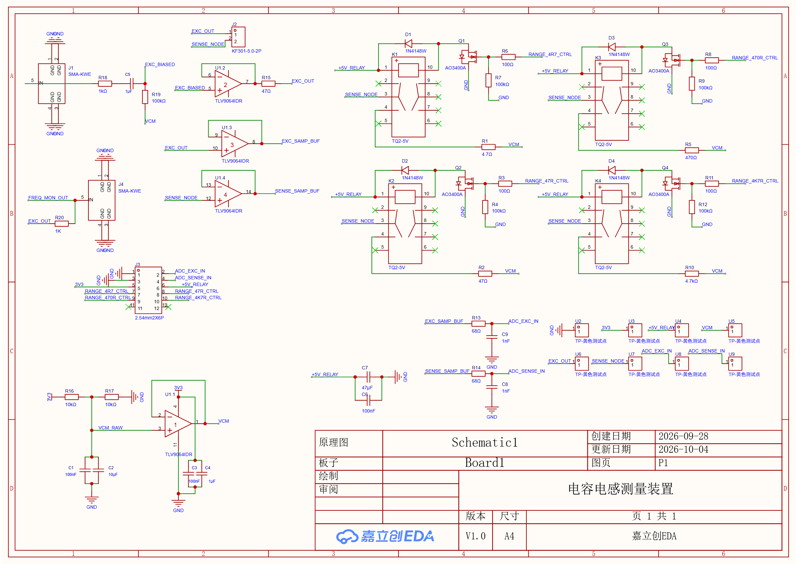

# MSPM0 Component Parameter Meter

基于天猛星 MSPM0G3507、AD9833 和自制模拟前端板的元器件参数测量装置。项目源于 2023 年全国大学生电子设计竞赛 C 题，目前重点实现电容测量、自动量程、双 ADC 同步采样和复阻抗计算。

> 本仓库仍处于实验阶段，不是已经完成校准的竞赛级仪器。连接被测元件前请先检查电源、VCM 和继电器状态。



## 当前状态

已完成并验证：

- AD9833 正弦输出控制，频率范围 `1 Hz` 至 `100 kHz`
- 已测试范围内输出约 `608 mVpp`，频率稳定
- 双 ADC DMA 采集、直流分量与峰峰值监测
- 四路继电器控制与先断后合保护
- 使用 R1（4.7 Ω）和 R3（470 Ω）的自动量程
- 串口命令控制与周期测量结果输出
- J-Link/SWD 构建、烧录和运行

实验性功能：

- 正弦/余弦最小二乘拟合
- 复阻抗 `Zx = Rref * (Vexc / Vsense - 1)`
- 电容值 `C_nF` 与损耗因数 `D` 计算

尚未完成：

- 1 nF 至 100 nF 全量程、±5% 精度验证
- 每个量程的开路、短路、增益和相位校准
- 电感及品质因数 Q 的完整计算和验证
- 最新复阻抗固件的系统化实物测试

## 已知硬件问题

- R2 链路实测行为更接近 470 Ω，而不是设计值 47 Ω
- R4 链路状态异常
- 自动量程因此只使用已确认可工作的 R1 和 R3
- UART BSL 在当前天猛星板上未成功握手，默认使用 J-Link/SWD 烧录

## 目录

```text
firmware/mspm0_autotest/  MSPM0G3507 固件
hardware/                 原理图截图和嘉立创 EDA Pro 工程
docs/                     接线、协议、硬件和测试说明
tools/                    串口、J-Link 和实验性 BSL 工具
mspm0.py                  统一命令入口
```

## 快速开始

依赖：

- Python 3.10+
- Arm GNU Toolchain，`arm-none-eabi-gcc` 位于 `PATH`
- TI MSPM0 SDK
- SEGGER J-Link Software（烧录时需要）

安装 Python 依赖：

```powershell
python -m pip install -r requirements.txt
```

设置 SDK 并构建：

```powershell
$env:MSPM0_SDK_ROOT = "C:\ti\mspm0_sdk_2_11_00_07"
python mspm0.py build
```

连接 J-Link 后烧录：

```powershell
python mspm0.py flash
```

打开交互串口：

```powershell
python mspm0.py console --port COM5
```

串口参数为 `9600 8N1`。完整命令见 [串口协议](docs/serial-protocol.md)，硬件连接见 [接线说明](docs/wiring.md)。

## 引脚摘要

| 功能 | MSPM0G3507 引脚 |
|---|---|
| AD9833 FSYNC | PA12 |
| AD9833 SCLK | PA13 |
| AD9833 SDATA | PA14 |
| ADC EXC | PA27 / ADC0 |
| ADC SENSE | PA15 / ADC1 |
| R1 4.7 Ω | PA8 |
| R2 47 Ω | PA9 |
| R3 470 Ω | PB4 |
| R4 4.7 kΩ | PB5 |
| UART TX / RX | PA10 / PA11 |

## 开源状态

仓库当前未附加开源许可证。除各文件中已有的第三方版权声明外，默认保留全部权利。
